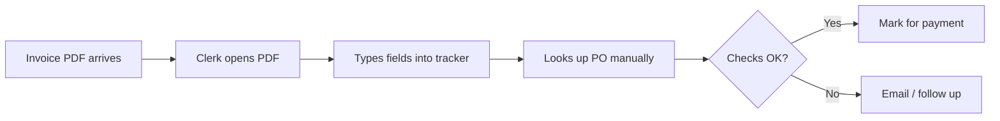
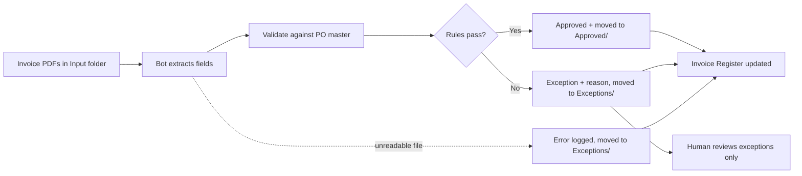

# AP Invoice Processing Bot (UiPath)

An RPA bot that automates **accounts payable invoice intake**. It reads supplier invoices (PDF), extracts the key fields, validates each invoice against the purchase order (PO) master, and routes it as **Approved** or **Exception**, with a clear reason, in an Excel invoice register.

Built with **UiPath Studio (C#)**, Excel and PDF activities.

---

## The business problem

In many finance teams, AP clerks open every supplier invoice by hand, key the details into a tracker, and check them against the PO before payment. That process is:

- **Slow:** every invoice is opened, read and typed in manually.
- **Error-prone:** typos, missed checks and inconsistent decisions.
- **Risky:** duplicate invoices, closed POs and overbilling can slip through and get paid.

This bot automates the repetitive part (reading, keying, checking) and sends only genuine problems to a human.

---

## Process: as-is vs. to-be

**As-is (manual)**


**To-be (automated)**


---

## What the bot does

1. **Loads the PO master** (`PO_Master.xlsx`) and the existing **Invoice Register** (if any).
2. **Reads each PDF invoice** in the input folder and extracts, using regex:
   Invoice number · Invoice date · Vendor · PO number · Total amount
   Handles **two different invoice layouts**: vendor from a `Vendor:` label, or from the document header.
3. **Validates** each invoice, in order. The first failed rule becomes the reason:

   | # | Rule | Exception reason |
   |---|------|------------------|
   | 1 | Invoice number not already in the register | Duplicate invoice number |
   | 2 | PO number present | Missing PO number |
   | 3 | PO exists in the PO master | PO not found |
   | 4 | PO status is Open | PO is closed |
   | 5 | Invoice vendor matches PO vendor | Vendor does not match PO vendor |
   | 6 | Invoice total ≤ approved PO amount | Amount exceeds PO (x vs y) |

4. **Writes the result** to the Invoice Register and **moves the PDF** to `Approved/` or `Exceptions/`.
5. **Handles failures per file:** a corrupted or unreadable PDF is caught, logged as **Error**, and moved to Exceptions, and the rest of the batch continues.

---

## Design decisions

- **Business vs. system exceptions.** Rule failures (e.g. overbilling) are *business exceptions*: expected, explained, routed to a human. Crashes such as an unreadable PDF are *system exceptions*, caught by a Try Catch around each invoice so one bad file never stops the run.
- **Register upsert (coalesce on file name).** Each run loads the existing register, removes previous rows for files in the current batch, then writes fresh results. Reprocessing a file **updates** its row instead of duplicating it, and history for other files is preserved, the same idea as coalescing on an import set in ServiceNow.
- **Duplicate detection across runs.** Because the register persists, a resent invoice is caught even if the original was processed in an earlier batch.
- **Deterministic ordering.** Files are processed in ordinal filename order. An early version used culture-sensitive sorting, which processed a resent copy *before* the original and flagged the wrong one. I caught this by testing against an answer key and fixed it with `StringComparer.Ordinal`. In production, files would be ordered by received timestamp.
- **Culture-safe amounts.** Totals are parsed with `InvariantCulture`, so `18,500.00` is read correctly regardless of the machine's regional settings.
- **Relative paths.** The bot runs from any clone of the repo without editing paths.

---

## Test results

The test set contains 13 realistic invoices (2 layouts) plus 1 deliberately corrupted file, covering every rule.

| Result | Count | Invoices |
|---|---|---|
| Approved | 7 | INV-1001, 1002, 1003, 1004, 1005, 1007, 1010 |
| Exception | 6 | 1002 (resent duplicate), 1006 (over PO), 1008 (PO not found), 1009 (missing PO), 1011 (PO closed), 1012 (vendor mismatch) |
| Error | 1 | INV-9999 (corrupted PDF) |

All results match the answer key in `Expected_Results.xlsx`.

---

## How to run

1. Install **UiPath Studio** (Community Edition is free) and clone this repo.
2. Open `project.json` in Studio. Packages restore automatically.
3. Copy the PDFs from `Data/ap_data/Samples` into `Data/ap_data/Input`.
4. (Optional) Delete `Data/ap_data/Outputs/Invoice_Register.xlsx` for a clean run.
5. Run `Main.xaml` (Ctrl+F5).
6. Check `Outputs/Invoice_Register.xlsx` and the `Approved/` and `Exceptions/` folders, and compare with `Expected_Results.xlsx`.

## Project structure
```
AP_Invoice_Processing/
├── Main.xaml                  # the workflow
├── project.json
└── Data/
    ├── ap_data/
    │   ├── Samples/           # master copy of test invoices (never modified)
    │   ├── Input/             # invoices to process
    │   ├── Outputs/           # Invoice_Register.xlsx
    │   ├── PO_Master.xlsx     # purchase orders
    │   └── Expected_Results.xlsx  # answer key
    ├── Approved/
    └── Exceptions/
```

*Built by Rana Ashraf: [LinkedIn](https://www.linkedin.com/in/rana-ashraf-563310344)
